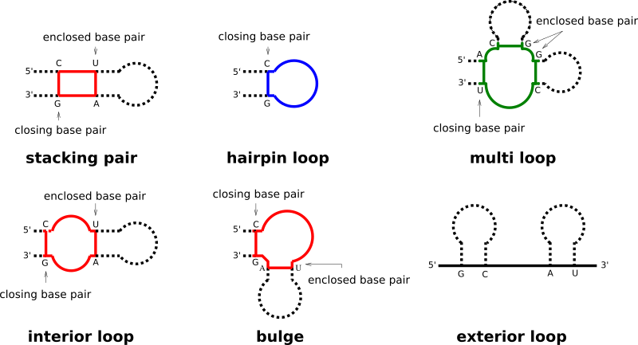
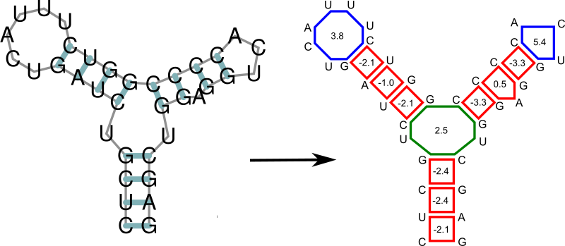

Free Energy Evaluation
======================

Under the **Nearest Neighbor** energy model secondary structures
:math:`s` are decomposed into individual loops :math:`L` and the
overall free energy :math:`E(s)` of a structure is estimated as
the sum of free energy contributions of the individual loops a
structure is composed of, i.e.:

.. math::

    E(s) = \sum_{L \in s} E_L

Here, we demonstrate how this is done and which parts of the
``RNAlib`` API are dedicated to free energy evaluation.

Loop Decomposition
------------------

Each base pair in a secondary structure closes a loop, thereby directly
enclosing unpaired nucleotides, and/or further base pairs. Our implementation
distinguishes four basic types of loops:

- hairpin loops
- internal loops
- multibranch loops
- exterior loop

While the exterior loop is a special case without a closing pair, the other
loops are determined by the number of base pairs involved in the loop formation,
i.e. hairpin loops are 1-loops, since only a single base pair delimits the loop.
internal loops are 2-loops due to their enclosing, and enclosed base pair. All
loops where more than two base pairs are involved, are termed multibranch loops.

Any secondary structure can be decomposed into its loops. Each of the loops then
can be scored in terms of free energy, and the free energy of an entire secondary
structure is simply the sum of free energies of its loops.

Energy Parameters
-----------------

For secondary structure free energy evaluation we usually utilize the set of
thermodynamic **Nearest Neighbor** energy parameters also used in other software,
such as ``UNAfold`` and ``RNAstructure``.

Available Parameter Sets
^^^^^^^^^^^^^^^^^^^^^^^^

While ``RNAlib`` already contains a compiled-in set of the latest
**Turner 2004 Free Energy Parameters**, we defined a file format that allows to
change these parameters at runtime. The ViennaRNA Package already comes with
a set of parameter files containing

- Turner 1999 RNA parameters
- Mathews 1999 DNA parameters
- Andronescu 2007 RNA parameters
- Mathews 2004 DNA parameters

.. seealso::

    The :ref:`api-energy-parameters` section provides a comprehensive overview
    of the related functions.

Salt Corrections
^^^^^^^^^^^^^^^^

The default Nearest Neighbor energy parameter set has been determined for monovalent
salt conditions (in particular sodium ion concentrations) of :math:`1\,M`. To adapt
the change in free energy for individual loops under different ion concentrations, we
provide an approach taken from :cite:t:`einert:2011`.

The implemented functions return correction terms in units of
:math:`\text{dcal} \cdot \text{mol}^{-1}`.

.. seealso::

    The :ref:`api-energy-parameters-salt` section provides a list of related functions.

.. tip::

    To preserve some backward compatibility the RNAlib also provides functions to
    convert energy parameter files from the format used in version 1.4-1.8 into the
    new format used since version 2.0. See :ref:`api-energy-parameters-convert` for
    details.

Fine-tuning of the Evaluation Model
-----------------------------------

.. seealso::

  :ref:`api-model-details`

Evaluate Individual Loops
-------------------------

To assess the free energy contribution of a particular loop :math:`L` within a
secondary structure, two variants are provided

* The *bare* free energy :math:`E_L` (usually in units of deka-calories, i.e.
  multiples of :math:`10 \text{cal} \cdot \text{mol}^{-1}`, and
* The *Boltzmann weight* :math:`q = exp(-\beta E_L)` of the free energy :math:`E_L`
  (with :math:`\beta = \frac{1}{RT}`, gas constant :math:`R` and temperature :math:`T`)

The latter is usually required for partition function computations.

.. contents:: Table of Contents
    :local:

.. seealso::

    Have a look at the :ref:`api-eval-loops` section for an overview of the available
    implementations.

Evaluate Atomic Moves
---------------------

A set of functions is available to assess the change in free energy upon minimal
structural changes, what we call *atomic moves*.

Here, atomic moves are not to be confused with moves of actual physical atoms. Instead,
an atomic move is considered the smallest conformational change a secondary structure
can undergo to form another, distinguishable structure. We currently support the
following moves

* Opening (dissociation) of a single base pair
* Closing (formation) of a single base pair
* Shifting one pairing partner of an existing pair to a different location

.. seealso::

    The :ref:`api-eval-moves` section provides an overview of the available
    implementations.

Evaluate Secondary Structures
-----------------------------

Several different functions to evaluate the free energy of a full secondary structure
under a particular set of parameters and the Nearest Neighbor Energy model are available
in ``RNAlib``.

For most of them, two different forms of representations for the secondary structure may
be used:

* The Dot-Bracket string
* A pair table representation

Furthermore, the evaluation functions are divided into **basic** and **simplified** variants,
where **basic** functions require the use of a :c:type:`vrna_fold_compound_t` data structure
holding the sequence string, and model configuration (settings and parameters).

The **simplified** functions, on the other hand, provide often used default model settings
that may be called directly with only sequence and structure data.

Finally, **verbose** variants exist for some functions that allow one to print the
(individual) free energy contributions to some ``FILE`` stream.

.. seealso::

    An overview of the available functions can be taken from the :ref:`api-eval-structures`
    section.
