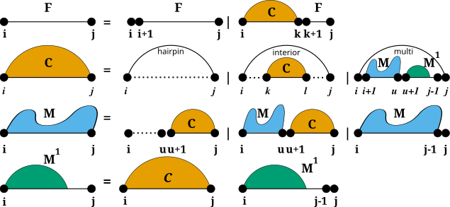
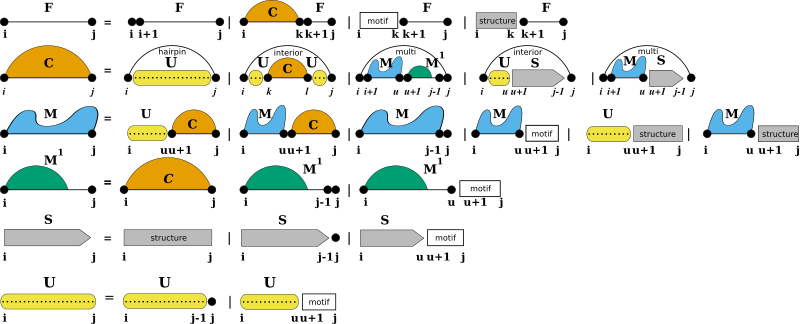
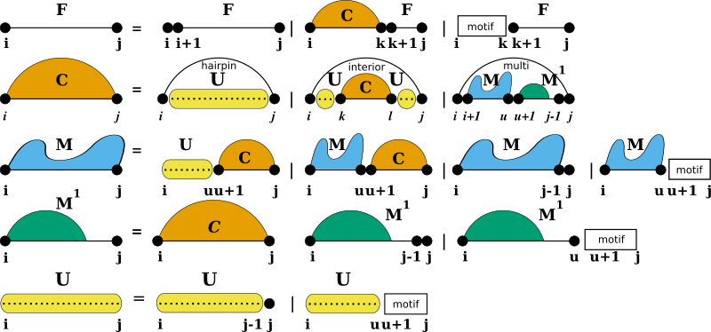

The RNA Folding Grammar
=======================

Introduction
------------

To predict secondary structures composed of the four distinguished loop types
introduced in :doc:`/advanced/eval`, all algorithms implemented in ``RNAlib``
follow a specific recursive decomposition scheme, also known as the
**RNA folding grammar**, or **Secondary Structure Folding Recurrences**.

Compared to other RNA secondary structure prediction libraries, our implementation
allows for a fine-grained control of the above recursions.

In particular, **secondary structure constraints** provide a very useful means
to control whether and how structures are taken into account by a prediction
algorithm and how they are evaluated. Here, we distinguish two groups:
:ref:`advanced-constraints-hard` and :ref:`advanced-constraints-soft`.

While **hard constraints** directly influence the production rules used in the folding
recursions by allowing, disallowing, or enforcing certain decomposition steps,
**soft constraints** are used to change position specific contributions
in the recursions by adding bonuses/penalties in form of pseudo free energies
to certain loop configurations.

.. note::

  Secondary structure constraints are always applied at decomposition level, i.e.
  in each step of the recursive structure decomposition, for instance during MFE
  prediction.

In contrast, some applications of RNA secondary structure prediction require
an extension of the *regular RNA folding grammar*. For instance one would
like to include proteins and other ligands binding to unpaired loop regions
while competing with conventional base pairing. Another application might be
that one may want to include the formation of self-enclosed structural modules,
e.g. *G-quadruplexes*. For such applications, we provide a pair of additional
domains that extend the regular RNA folding grammar: :ref:`advanced-domains-bp`
and :ref:`advanced-domains-up`.

While **unstructured domains** are usually determined by a more or less precise
sequence motif, e.g. the binding site for a protein, **structured domains** are
considered self-enclosed modules with a more or less complex pairing pattern.
Our extension with these two domains introduces two production rules to fill
additional dynamic processing matrices ``S`` and ``U`` where we store the
pre-computed contributions of structured domains (``S``), and unstructured
domains (``U``).

.. seealso::

    :doc:`/ligands/unstructured_domains`.
    :ref:`api-grammar-constraints` lists all related constraints related API symbols.

.. _advanced-constraints-hard:

Hard Constraints
----------------

Hard constraints as implemented in our library can be specified for individual loop
types, i.e. the atomic derivations of the RNA folding grammar rules. Hence, the pairing
behavior of both, single nucleotides and pairs of bases, can be constrained in every
loop context separately. Additionally, an abstract implementation using a callback
mechanism allows for full control of more complex hard constraints.

The following option flags may be used to constrain the pairing behavior of single,
or pairs of nucleotides:

* :c:macro:`VRNA_CONSTRAINT_CONTEXT_EXT_LOOP`
* :c:macro:`VRNA_CONSTRAINT_CONTEXT_HP_LOOP`
* :c:macro:`VRNA_CONSTRAINT_CONTEXT_INT_LOOP`
* :c:macro:`VRNA_CONSTRAINT_CONTEXT_INT_LOOP_ENC`
* :c:macro:`VRNA_CONSTRAINT_CONTEXT_MB_LOOP`
* :c:macro:`VRNA_CONSTRAINT_CONTEXT_MB_LOOP_ENC`
* :c:macro:`VRNA_CONSTRAINT_CONTEXT_ENFORCE`
* :c:macro:`VRNA_CONSTRAINT_CONTEXT_NO_REMOVE`
* :c:macro:`VRNA_CONSTRAINT_CONTEXT_ALL_LOOPS`

.. seealso::

    A full list of available functions and data structures for hard constraints can
    be found under :ref:`api-grammar-constraints-hard`.

.. _advanced-constraints-soft:

Soft Constraints
----------------

Soft-constraints are used to change position specific contributions in the recursions
by adding bonuses/penalties in form of pseudo free energies to certain loop configurations.

For the sake of memory efficiency, we do not implement a loop context aware version of
soft constraints. The *static* soft constraints as implemented only distinguish unpaired
from paired nucleotides. This is usually sufficient for most use-case scenarios.
However, similar to hard constraints, an abstract soft constraints implementation using
a callback mechanism exists, that allows for any soft constraint that is compatible with
the RNA folding grammar. Thus, loop contexts and even individual decomposition rules can
be addressed separately for maximum flexibility in soft-constraints application.

Soft constraint callback functions will always be notified about the type of decomposition
that is happening, and the corresponding delimiting sequence positions. The following
decomposition steps are distinguished, and should be captured by the user's implementation
of the callback:

* :c:macro:`VRNA_DECOMP_PAIR_HP`
* :c:macro:`VRNA_DECOMP_PAIR_IL`
* :c:macro:`VRNA_DECOMP_PAIR_ML`
* :c:macro:`VRNA_DECOMP_ML_ML_ML`
* :c:macro:`VRNA_DECOMP_ML_STEM`
* :c:macro:`VRNA_DECOMP_ML_ML`
* :c:macro:`VRNA_DECOMP_ML_UP`
* :c:macro:`VRNA_DECOMP_ML_ML_STEM`
* :c:macro:`VRNA_DECOMP_ML_COAXIAL`
* :c:macro:`VRNA_DECOMP_EXT_EXT`
* :c:macro:`VRNA_DECOMP_EXT_UP`
* :c:macro:`VRNA_DECOMP_EXT_STEM`
* :c:macro:`VRNA_DECOMP_EXT_EXT_EXT`
* :c:macro:`VRNA_DECOMP_EXT_STEM_EXT`
* :c:macro:`VRNA_DECOMP_EXT_STEM_OUTSIDE`
* :c:macro:`VRNA_DECOMP_EXT_EXT_STEM`
* :c:macro:`VRNA_DECOMP_EXT_EXT_STEM1`

Energy Precision and Accumulation
^^^^^^^^^^^^^^^^^^^^^^^^^^^^^^^^^

For single-sequence folding, :c:func:`vrna_sc_add_up` and
:c:func:`vrna_sc_add_bp` accumulate pseudo free energy contributions for each
unpaired nucleotide or base pair without first rounding them to 0.01 kcal/mol.
The corresponding :c:func:`vrna_sc_set_up` and :c:func:`vrna_sc_set_bp`
functions replace the stored contributions and also retain fractional values.

Partition function calculations use the stored values without rounding to a
fixed energy increment. This allows ensemble energies and base-pair
probabilities to respond continuously to these soft constraints. MFE
calculations retain the existing integer energy scale: each accumulated
nucleotide or base-pair contribution is rounded to the nearest 0.01 kcal/mol.
For an unpaired stretch, the rounded contributions of its nucleotides are
summed.

For example, adding 0.003 kcal/mol twice to the same nucleotide gives a stored
contribution of 0.006 kcal/mol and an MFE contribution of 0.01 kcal/mol:

.. code-block:: python

    import RNA

    fc = RNA.fold_compound("AAAAAA")
    fc.sc_add_up(3, 0.003)
    fc.sc_add_up(3, 0.003)
    print(f"{fc.mfe()[1]:.2f}")  # 0.01 kcal/mol
    print(f"{fc.pf()[1]:.3f}")   # 0.006 kcal/mol

These rules also apply to negative contributions. The floating-point
precision of PF tables still depends on whether ViennaRNA was configured
with ``--enable-floatpf``. Comparative folding APIs and stack soft constraints
retain their existing rounding behavior.

.. note::

    Since v2.8 MFE rounding uses the stored double value directly. Values very
    close to a rounding boundary may therefore produce a different result from
    older versions, which first converted the contribution to float. For example,
    0.0049999999 kcal/mol rounds to 0.00 kcal/mol. This also applies to soft
    constraints derived from probing data.

.. seealso::

    High-level interfaces that build upon the soft constraints framework
    can be obtained by the implementations in the submodules:

    * :doc:`modified_bases`
    * :doc:`probing_data`
    * :doc:`ligands`

    A full list of available functions and data structures for soft constraints can
    be found under :ref:`api-grammar-constraints-soft`.

.. _advanced-domains-up:

Unstructured Domains
--------------------

Unstructured domains appear in the production rules of the RNA folding grammar
wherever new unpaired nucleotides are attached to a growing substructure
(see also :cite:t:`lorenz:2016b`):

The white boxes represent the stretch of RNA bound to the ligand and represented
by a more or less specific sequence motif. The motif itself is considered unable
to form base pairs. The additional production rule ``U`` is used to precompute
the contribution of unpaired stretches possibly bound by one or more ligands.
The auxiliary DP matrix for this production rule is filled right before
processing the other (regular) production rules of the RNA folding grammar.

Implementation
^^^^^^^^^^^^^^

Our implementation provides the tools to add and modify unstructured domains
to the production rules of the RNA folding grammar. Usually this functionality
is utilized for incorporating ligand binding to unpaired stretches of an RNA.

.. warning::

    Although the additional production rule(s) for unstructured domains as descibed here
    are always treated as *segments possibly bound to one or more ligands*, the current
    implementation requires that at least one ligand is bound. The default implementation
    already takes care of the required changes, however, upon using callback functions
    other than the default ones, one has to take care of this fact. Please also note,
    that this behavior might change in the future such that the decomposition schemes as
    shown above comply with the actual implementation.

A default implementation allows one to readily use this feature by simply adding sequence motifs and corresponding
binding free energies with the function :c:func:`vrna_ud_add_motif()` (see also :doc:`/ligands/unstructured_domains`).

The grammar extension is realized using a callback function that

* evaluates the binding free energy of a ligand to its target sequence segment (white boxes in the figures above), or
* returns the free energy of an unpaired stretch possibly bound by a ligand, stored in the additional ``U`` DP matrix.

The callback is passed the segment positions, the loop context, and which of the two above mentioned
evaluations are required. A second callback implements the pre-processing step that
prepares the ``U`` DP matrix by evaluating all possible cases of the additional production rule.
Both callbacks have a default implementation in *RNAlib*, but may be over-written by a
user-implementation, making it fully user-customizable.

For equilibrium probability computations, two additional callbacks exist. One to store/add and one to retrieve the
probability of unstructured domains at particular positions. Our implementation already takes care of computing
the probabilities, but users of the unstructured domain feature are required to provide a mechanism to efficiently
store/add the corresponding values into some external data structure.

For the sake of flexibility, each of the domains is associated with a specific
data structure serving as an abstract interface to the extension. The interface
uses callback functions to

* pre-compute arbitrary data, e.g. filling up additional dynamic programming matrices, and
* evaluate the contribution of a paired or unpaired structural feature of the RNA.

Implementations of these callbacks are separate for regular free energy evaluation,
e.g. MFE prediction, and partition function applications. A data structure holding
arbitrary data required for the callback functions can be associated to the domain
as well. While *RNAlib* comes with a default implementation for structured and
unstructured domains, the system is entirely user-customizable.

.. seealso::

    The available API can be viewed in detail here: :ref:`api-grammar-domains-up`

.. _advanced-domains-bp:

Structured Domains
------------------

Usually, structured domains represent self-enclosed structural modules that
exhibit a more or less complex base pairing pattern. This can be more or less
well-defined 3D motifs, such as *G-Quadruplexes*, or loops with additional
non-canonical base pair interactions, such as *kink-turns*.

.. note::

    At the time of writing, our implementation only provides the specialized case of *G-Quadruplexes*.

.. seealso::

    The available API can be viewed in detail here: :ref:`api-grammar-domains-bp`

Extending the RNA Folding Grammar
---------------------------------

The RNA folding grammar can be easily extended by additional user-provided
rules. For that purpose, we implement a generic callback-based machinery, that
allows one to add rules to the existing decomposition stages ``F``, ``C``, ``M``,
and ``M1``. If such an extension is not sufficient, users may even extend the
grammar by arbitrary additional derivations.

Additional rules can be supplied for both, MFE and partition function computations.
Here, a set of two callback functions must be provided, one for the *inside*, and
another for the *outside* recursions. The functions will then be called at appropriate
steps in the recursions automatically. Each function will be provided with a
set of parameters for the decomposition step and a user-defined data pointer that
may point to some memory storing any additional data required for the grammar rule.

.. seealso::

    The detailed API for this mechanism can be found in :ref:`api-grammar-extension`
